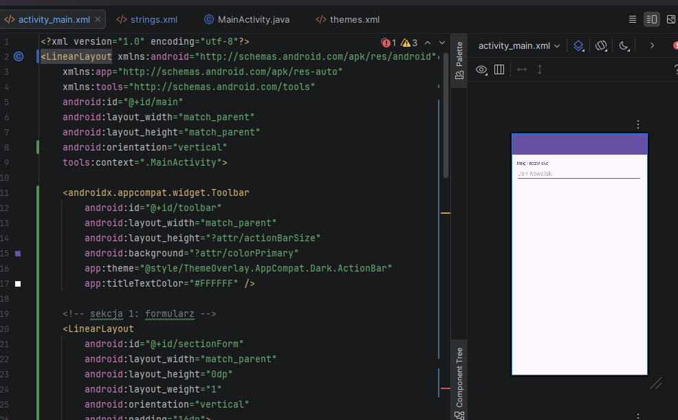

   
   
   

   

Po zamianie `app:showAsAction` na `android:showAsAction` 
projekt kompiluje się bez błędu, ale atrybut z przestrzeni `android:` 
jest ignorowany przez pasek narzędzi z biblioteki zgodności/Material. 
W efekcie pozycje (nawet oznaczone jako `always` czy `ifRoom`) 
trafiają pod menu trzech kropek zamiast wyświetlać się na pasku. 

Wywołanie `return super.onOptionsItemSelected(item);` 
przekazuje nieobsłużone przez naszą aktywność zdarzenia 
dalej do klasy nadrzędnej – dzięki temu działa m.in. 
standardowa obsługa strzałki powrotu (`android.R.id.home`, np. powrót do aktywności wskazanej w `android:parentActivityName`). 
Zwrócenie `return false;` przerywa przekazywanie zdarzenia do klasy nadrzędnej i może zablokować domyślne zachowanie systemu.